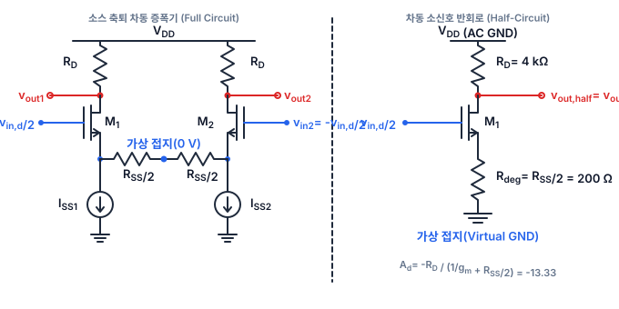
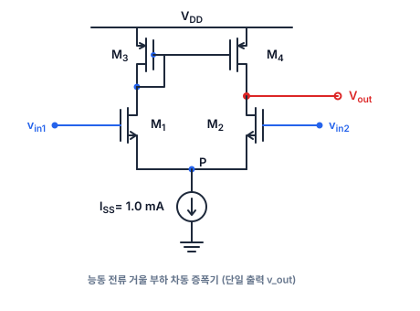

# Q4. 소스 축퇴 차동쌍 반회로 해석 및 능동 전류 거울 부하 차동쌍 (배점: 20점)

## 원문

다음 두 차동 증폭기 회로에 대해 회로 해석 기법을 적용하여 질문에 답하시오. (총 20점)

(a) [10점] 소스 축퇴 저항 $R_{SS}$를 갖는 MOS 차동 증폭기의 반회로 해석 및 차동 이득
그림 (a)는 입력 트랜지스터 $M_1, M_2$의 소스 노드 사이에 축퇴 저항 $R_{SS} = 400\,\Omega$가 연결되어 선형성을 개선한 차동 증폭기이다. 각 소스 단자는 이상적인 테일 전류원 $I_{SS1} = I_{SS2} = 0.5\,\text{mA}$에 의해 접지로 바이어스되며, 각 드레인 부하 저항은 $R_D = 4\,\text{k}\Omega$이다.
(1) 순수 차동 입력 신호 인가 시 중심 노드가 가상 접지가 되는 이유를 설명하고 차동 반회로 등가 모델을 도출하시오.
(2) 차동 반회로 모델을 이용하여 차동 전압 이득 $A_d = (v_{out1} - v_{out2}) / (v_{in1} - v_{in2})$의 대수식을 유도하고 수치를 계산하시오.

(b) [10점] 능동 전류 거울 부하를 갖는 단일 출력 차동 증폭기
그림 (b)는 NMOS 차동 입력쌍 $M_1, M_2$와 PMOS 능동 전류 거울($M_3, M_4$) 부하로 구성된 단일단 출력 차동 증폭기이다. 테일 전류원 $I_{SS} = 1.0\,\text{mA}$에 의해 각 브랜치에 $I_{D1} = I_{D2} = 0.5\,\text{mA}$의 직류 전류가 흐른다.
(1) 차동 입력 신호 인가 시 신호 전류가 출력 노드에서 보강 합성되는 과정을 설명하고 단락 트랜스컨덕턴스 $G_m$을 유도 및 계산하시오.
(2) 소신호 출력 저항 $R_{out}$과 차동-단일단 전압 이득 $A_v = v_{out} / (v_{in1} - v_{in2})$를 구하시오.

## 조건

- (a) $\mu_n C_{ox} = 100\,\mu\text{A/V}^2$, $(W/L)_{1,2} = 1000$, $\lambda = 0$, $I_{SS1} = I_{SS2} = 0.5\,\text{mA}$, $R_{SS} = 400\,\Omega$, $R_D = 4\,\text{k}\Omega$
- (b) $\mu_n C_{ox} = 100\,\mu\text{A/V}^2$, $\mu_p C_{ox} = 50\,\mu\text{A/V}^2$, $\lambda_n = \lambda_p = 0.1\,\text{V}^{-1}$, $(W/L)_{1,2} = 1000$, $(W/L)_{3,4} = 2000$, $I_{SS} = 1.0\,\text{mA}$, $g_m r_o \gg 1$

## 구할 것

- (a) 가상 접지 증명 및 반회로 등가 모델 도출 (5점), 차동 이득 $A_d$ 유도 및 계산 (5점)
- (b) 신호 전류 합성 과정 및 $G_m$ 계산 (5점), $R_{out}$ 및 전압 이득 $A_v$ 계산 (5점)

## 회로

- 회로 (a): 소스 축퇴 저항 $R_{SS}$ 차동 증폭기 및 소신호 반회로
- 회로 (b): 능동 전류 거울 부하 단일단 출력 차동 증폭기

---

## 풀이

### (a) 소스 축퇴 차동 증폭기 반회로 모델링 및 $A_d$ 유도 [10점]

#### 1. 가상 접지(Virtual Ground) 원리 및 반회로 도출
- 차동 입력 신호 $v_{in1} = +v_{in,d}/2$, $v_{in2} = -v_{in,d}/2$가 인가될 때 회로는 완전한 역위상 반대칭(Anti-symmetry)으로 구동된다.
- 소스 노드 $S_1$과 $S_2$의 소신호 전압 변동을 $v_{s1}, v_{s2}$라 하면, 회로의 대칭성에 의해 다음 관계가 성립한다:
$$v_{s1} = -v_{s2}$$
- 두 소스 단자 사이에 연결된 저항 $R_{SS}$를 동일한 두 저항의 직렬 연결($R_{SS}/2 + R_{SS}/2$)로 표현하면, 그 정중앙 노드의 전압 $v_{mid}$는 다음과 같다:
$$v_{mid} = \frac{v_{s1} + v_{s2}}{2} = \frac{v_{s1} + (-v_{s1})}{2} = 0\,\text{V}$$
- 즉, 중앙 노드는 소신호 교류 접지(Virtual Ground)가 된다. 또한 직류 테일 전류원 $I_{SS1}, I_{SS2}$는 소신호 해석에서 개방 회로(Open-circuit)로 치환된다.
- 따라서 왼쪽 입력 $M_1$에 대한 차동 반회로는 다음과 같이 분리된다:
  - 입력 전압: $v_{in,half} = +v_{in,d}/2$
  - 소스 저항: 소스 단자와 가상 접지 사이에 연결된 $R_{SS}/2$
  - 드레인 부하 저항: 드레인 단자와 소신호 접지($V_{DD}$) 사이에 연결된 $R_D$
  - 출력 전압: $v_{out,half} = v_{out1}$

#### 2. 소신호 파라미터 및 차동 이득 $A_d$ 유도
- $M_1$의 직류 바이어스 전류는 $I_{D1} = 0.5\,\text{mA}$이다.
- 트랜스컨덕턴스 $g_{m1}$ 계산:
$$g_{m1} = \sqrt{2 \mu_n C_{ox} \left(\frac{W}{L}\right)_1 I_{D1}} = \sqrt{2 \times 100\,\mu\text{A/V}^2 \times 1000 \times 0.5\,\text{mA}} = \sqrt{0.1} = 10.0\,\text{mS}$$
$$\frac{1}{g_{m1}} = \frac{1}{10.0\,\text{mS}} = 100\,\Omega$$
- 반회로의 소스 축퇴 저항:
$$R_{deg} = \frac{R_{SS}}{2} = \frac{400\,\Omega}{2} = 200\,\Omega$$
- 소스 축퇴된 공통 소스 증폭기의 반회로 전압 이득:
$$A_{v,half} = \frac{v_{out1}}{v_{in,d}/2} = -\frac{R_D}{\frac{1}{g_{m1}} + \frac{R_{SS}}{2}} = -\frac{4000\,\Omega}{100\,\Omega + 200\,\Omega} = -\frac{4000}{300} = -\frac{40}{3} \approx -13.33$$
- 반대편 브랜치에서는 반대 위상 $v_{out2} = -v_{out1}$이 출력되므로 차동 출력 전압은:
$$v_{out,d} = v_{out1} - v_{out2} = 2 v_{out1} = 2 A_{v,half} \left(\frac{v_{in,d}}{2}\right) = A_{v,half} v_{in,d}$$
- 따라서 전체 차동 전압 이득 $A_d$는 반회로 이득과 완전히 동일하다:
$$A_d = \frac{v_{out1} - v_{out2}}{v_{in1} - v_{in2}} = -\frac{R_D}{\frac{1}{g_{m1}} + \frac{R_{SS}}{2}} = -\frac{40}{3} \approx -13.33$$

---

### (b) 능동 전류 거울 부하 차동 증폭기 해석 [10점]

#### 1. 신호 전류 보강 합성 및 $G_m$ 유도
- 차동 입력 $v_{in,d} = v_{in1} - v_{in2}$가 인가될 때, 두 입력 트랜지스터에 유도되는 차동 소신호 드레인 전류는 다음과 같다:
$$i_{d1} = g_{m1} \frac{v_{in,d}}{2}, \quad i_{d2} = -g_{m1} \frac{v_{in,d}}{2}$$
- $M_1$의 드레인 전류 $i_{d1}$은 다이오드 연결된 PMOS 트랜지스터 $M_3$로 유입된다.
- $M_3$와 $M_4$는 종횡비가 동일한 1:1 전류 거울을 형성하므로, $M_4$의 드레인 전류 $i_{d4}$는 $i_{d1}$을 그대로 복사하여 출력 노드로 밀어 넣는다(Source):
$$i_{d4} = i_{d1} = g_{m1} \frac{v_{in,d}}{2}$$
- 한편, $M_2$는 드레인(출력 노드)으로부터 접지 방향으로 전류 $i_{d2}$를 끌어당긴다(Sink):
$$i_{d2} = -g_{m1} \frac{v_{in,d}}{2}$$
- 출력 노드를 가상 접지($v_{out} = 0$)로 단락시켰을 때, 부하로 흘러 나가는 전체 단락 전류 $i_{out,sc}$는 $M_4$가 공급하는 전류와 $M_2$가 당기는 전류의 차이다:
$$i_{out,sc} = i_{d4} - i_{d2} = g_{m1} \frac{v_{in,d}}{2} - \left(-g_{m1} \frac{v_{in,d}}{2}\right) = g_{m1} v_{in,d}$$
- 즉, 능동 전류 거울이 $M_1$의 신호 전류 위상을 180도 반전시켜 출력단에서 $M_2$의 신호 전류와 동일한 위상으로 더해지도록(보강 합성) 만든다.
- 따라서 단락 트랜스컨덕턴스 $G_m$은 다음과 같다:
$$G_m = \left.\frac{i_{out,sc}}{v_{in,d}}\right|_{v_{out}=0} = g_{m1}$$
- 파라미터 대입 수치 계산 ($I_{D1} = 0.5\,\text{mA}$, $(W/L)_1 = 1000$):
$$g_{m1} = \sqrt{2 \times 100\,\mu\text{A/V}^2 \times 1000 \times 0.5\,\text{mA}} = 10.0\,\text{mS}$$
$$G_m = 10.0\,\text{mS}$$

#### 2. 소신호 출력 저항 $R_{out}$ 및 전압 이득 $A_v$ 계산
- 소신호 파라미터 계산:
$$r_{o2} = \frac{1}{\lambda_n I_{D2}} = \frac{1}{0.1\,\text{V}^{-1} \times 0.5\,\text{mA}} = 20.0\,\text{k}\Omega$$
$$g_{m3} = g_{m4} = \sqrt{2 \mu_p C_{ox} \left(\frac{W}{L}\right)_{3,4} I_D} = \sqrt{2 \times 50\,\mu\text{A/V}^2 \times 2000 \times 0.5\,\text{mA}} = 10.0\,\text{mS}$$
$$r_{o4} = \frac{1}{\lambda_p I_{D4}} = \frac{1}{0.1\,\text{V}^{-1} \times 0.5\,\text{mA}} = 20.0\,\text{k}\Omega$$
- 출력 노드 $V_{out}$에서 바라본 소신호 출력 저항은 아래쪽 NMOS $M_2$의 출력 저항과 위쪽 PMOS $M_4$의 출력 저항의 병렬 연결이다:
$$R_{out} = r_{o2} \parallel r_{o4} = 20.0\,\text{k}\Omega \parallel 20.0\,\text{k}\Omega = 10.0\,\text{k}\Omega$$
- 전압 이득 계산:
$$v_{in1} \text{ 상승 시 } i_{d1} \uparrow \implies i_{d4} \uparrow \implies v_{out} \uparrow$$
- 따라서 차동 입력에 대한 단일단 출력 전압 이득은 양수(비반전)이며 다음과 같다:
$$A_v = \frac{v_{out}}{v_{in1} - v_{in2}} = G_m R_{out} = g_{m1} (r_{o2} \parallel r_{o4}) = 10.0\,\text{mS} \times 10.0\,\text{k}\Omega = 100$$

---

### 답

- **(a)** $R_{SS}$ 중앙 노드는 반대칭 구동에 의해 소신호 전압 변동이 0인 가상 접지($v_{mid} = 0$)를 형성한다. 차동 반회로 이득 $A_d = -\frac{R_D}{1/g_{m1} + R_{SS}/2} = -\frac{4\,\text{k}\Omega}{100\,\Omega + 200\,\Omega} \approx -13.33$.
- **(b)** $M_1$의 신호 전류가 능동 거울을 통해 반전되어 출력단에서 $M_2$의 전류와 동일한 위상으로 더해져 단락 트랜스컨덕턴스는 $G_m = g_{m1} = 10.0\,\text{mS}$이다. 출력 저항 $R_{out} = 10.0\,\text{k}\Omega$, 전압 이득 $A_v = +100$.
