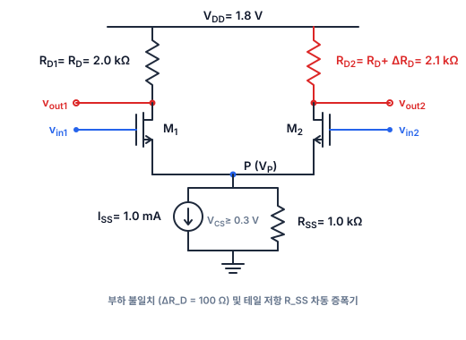

# Q5. 부하 저항 불일치 ΔRD 차동 증폭기의 Vin,CM 범위, ACM-DM, CMRR (배점: 20점)

## 원문

그림의 NMOS 차동 증폭기는 공정 불일치로 인해 두 드레인 부하 저항이 $R_{D1} = R_D = 2.0\,\text{k}\Omega$, $R_{D2} = R_D + \Delta R_D = 2.1\,\text{k}\Omega$ ($\Delta R_D = 100\,\Omega$)로 비대칭이다. 테일 전류원은 직류 바이어스 전류 $I_{SS} = 1.0\,\text{mA}$를 공급하며, 유한한 소신호 테일 저항 $R_{SS} = 1.0\,\text{k}\Omega$를 갖는다. 전류원이 정상 동작하기 위해 필요한 최소 양단 전압은 $V_{CS} = 0.3\,\text{V}$이다.

다음 질문에 답하시오. (총 20점)

(1) [5점] 두 입력 트랜지스터 $M_1, M_2$가 모두 포화 영역(Saturation Region)에 머무르고 테일 전류원이 정상 동작하기 위한 입력 공통 모드 전압의 허용 범위 $V_{in,CM,min} \le V_{in,CM} \le V_{in,CM,max}$를 구하시오.

(2) [5점] 차동 전압 이득 $A_d = (v_{out1} - v_{out2}) / (v_{in1} - v_{in2})$와 단일단/평균 공통 모드 전압 이득 $A_{CM}$의 대수식을 유도하고 수치를 계산하시오.

(3) [5점] 공통 모드 입력 신호가 차동 출력 신호로 변환되는 공통 모드-차동 모드 변환 이득 $A_{CM-DM} = (v_{out1} - v_{out2}) / v_{in,CM}$의 대수식을 유도하고 수치를 계산하시오.

(4) [5점] 공통 모드 제거비 $\text{CMRR} = |A_d / A_{CM-DM}|$의 절대값 및 데시벨($\text{dB}$) 값을 계산하시오.

## 조건

- $V_{DD} = 1.8\,\text{V}$, $\mu_n C_{ox} = 100\,\mu\text{A/V}^2$, $(W/L)_{1,2} = 1000$, $V_{TH} = 0.4\,\text{V}$, $\lambda = 0$
- $I_{SS} = 1.0\,\text{mA}$, $R_{SS} = 1.0\,\text{k}\Omega$, $V_{CS} = 0.3\,\text{V}$
- $R_{D1} = 2.0\,\text{k}\Omega$, $R_{D2} = 2.1\,\text{k}\Omega$ ($\Delta R_D = 100\,\Omega$)

## 구할 것

- (1) $V_{in,CM}$ 허용 범위 $[V_{in,CM,min}, V_{in,CM,max}]$ (5점)
- (2) 차동 이득 $A_d$ 및 공통 모드 이득 $A_{CM}$ (5점)
- (3) 변환 이득 $A_{CM-DM}$ (5점)
- (4) $\text{CMRR}$ 절대값 및 $\text{dB}$ 값 (5점)

## 회로

- 부하 불일치 $\Delta R_D$와 테일 저항 $R_{SS}$를 갖는 NMOS 차동 증폭기

---

## 풀이

### (1) 입력 공통 모드 전압 범위 $V_{in,CM}$ [5점]

#### 1. 직류 바이어스 동작점 계산
- $M_1, M_2$가 대칭적으로 온(On) 상태일 때 직류 바이어스 전류는 테일 전류를 균등하게 양분한다:
$$I_{D1} = I_{D2} = \frac{I_{SS}}{2} = \frac{1.0\,\text{mA}}{2} = 0.5\,\text{mA}$$
- $M_1, M_2$의 오버드라이브 전압 $V_{ov} = V_{GS} - V_{TH}$:
$$I_D = \frac{1}{2} \mu_n C_{ox} \left(\frac{W}{L}\right) (V_{GS} - V_{TH})^2$$
$$0.5\,\text{mA} = \frac{1}{2} \times \left(100\,\mu\text{A/V}^2 \times 1000\right) \times (V_{GS} - 0.4\,\text{V})^2 = \frac{1}{2} \times 100\,\text{mA/V}^2 \times (V_{GS} - 0.4\,\text{V})^2$$
$$(V_{GS} - 0.4\,\text{V})^2 = \frac{2 \times 0.5\,\text{mA}}{100\,\text{mA/V}^2} = 0.01\,\text{V}^2 \implies V_{ov} = V_{GS} - 0.4\,\text{V} = 0.1\,\text{V}$$
$$V_{GS} = 0.5\,\text{V}$$
- 두 트랜지스터의 직류 드레인 전압:
$$V_{D1} = V_{DD} - I_{D1} R_{D1} = 1.8\,\text{V} - 0.5\,\text{mA} \times 2.0\,\text{k}\Omega = 1.8\,\text{V} - 1.0\,\text{V} = 0.80\,\text{V}$$
$$V_{D2} = V_{DD} - I_{D2} R_{D2} = 1.8\,\text{V} - 0.5\,\text{mA} \times 2.1\,\text{k}\Omega = 1.8\,\text{V} - 1.05\,\text{V} = 0.75\,\text{V}$$

#### 2. $V_{in,CM,min}$ 계산 (테일 전류원 포화 유지 조건)
- 테일 노드 $P$의 전압은 $V_P = V_{in,CM} - V_{GS}$이다.
- 테일 전류원이 정상 동작하기 위해 $V_P \ge V_{CS} = 0.3\,\text{V}$이어야 하므로:
$$V_{in,CM} - V_{GS} \ge V_{CS} \implies V_{in,CM,min} = V_{CS} + V_{GS} = 0.3\,\text{V} + 0.5\,\text{V} = 0.80\,\text{V}$$

#### 3. $V_{in,CM,max}$ 계산 (입력 트랜지스터 포화 영역 유지 조건)
- $M_1, M_2$가 포화 영역에 머물기 위해서는 드레인-소스 전압이 오버드라이브 전압 이상이어야 한다:
$$V_{DS} \ge V_{GS} - V_{TH} \implies V_D \ge V_G - V_{TH} \implies V_{in,CM} \le V_D + V_{TH}$$
- 드레인 전압 중 더 낮은 값은 $R_{D2}$가 더 큰 $M_2$의 드레인 전압 $V_{D2} = 0.75\,\text{V}$이다:
$$V_{in,CM,max} = V_{D2} + V_{TH} = 0.75\,\text{V} + 0.4\,\text{V} = 1.15\,\text{V}$$
- 따라서 입력 공통 모드 전압 범위는 다음과 같다:
$$0.80\,\text{V} \le V_{in,CM} \le 1.15\,\text{V}$$

---

### (2) 차동 이득 $A_d$ 및 공통 모드 이득 $A_{CM}$ [5점]

#### 1. 소신호 파라미터 계산
$$g_m = \frac{2 I_D}{V_{ov}} = \frac{2 \times 0.5\,\text{mA}}{0.1\,\text{V}} = 10.0\,\text{mS}$$
$$\frac{1}{g_m} = 100\,\Omega$$

#### 2. 차동 전압 이득 $A_d$ 유도 및 계산
- 순수 차동 입력 $v_{in1} = +v_{in,d}/2$, $v_{in2} = -v_{in,d}/2$ 인가 시 테일 노드는 가상 접지($v_P = 0$)이다.
- 두 소신호 드레인 전류:
$$i_{d1} = +g_m \frac{v_{in,d}}{2}, \quad i_{d2} = -g_m \frac{v_{in,d}}{2}$$
- 각 출력 전압:
$$v_{out1} = -i_{d1} R_{D1} = -g_m R_{D1} \frac{v_{in,d}}{2}$$
$$v_{out2} = -i_{d2} R_{D2} = +g_m R_{D2} \frac{v_{in,d}}{2}$$
- 차동 출력 전압 $v_{out,d} = v_{out1} - v_{out2}$:
$$v_{out,d} = -g_m \frac{R_{D1} + R_{D2}}{2} v_{in,d} = -g_m \left(R_D + \frac{\Delta R_D}{2}\right) v_{in,d}$$
$$A_d = \frac{v_{out,d}}{v_{in,d}} = -g_m \left(R_D + \frac{\Delta R_D}{2}\right)$$
- 수치 대입:
$$R_D + \frac{\Delta R_D}{2} = 2.0\,\text{k}\Omega + 0.05\,\text{k}\Omega = 2.05\,\text{k}\Omega$$
$$A_d = -10.0\,\text{mS} \times 2.05\,\text{k}\Omega = -20.5$$
- (공칭 근사 $A_d \approx -g_m R_D = -20.0$도 가능)

#### 3. 순수 공통 모드 이득 $A_{CM}$ 유도 및 계산
- 양쪽 게이트에 공통 모드 입력 $v_{in,CM}$ 인가 시 테일 노드 전압:
$$v_P = \frac{R_{SS}}{R_{SS} + \frac{1}{2 g_m}} v_{in,CM} = \frac{2 g_m R_{SS}}{1 + 2 g_m R_{SS}} v_{in,CM}$$
- 각 트랜지스터의 소신호 드레인 전류:
$$i_{d1} = i_{d2} = g_m (v_{in,CM} - v_P) = \frac{g_m}{1 + 2 g_m R_{SS}} v_{in,CM}$$
- 평균 공통 모드 출력 전압 $v_{out,CM} = (v_{out1} + v_{out2}) / 2$:
$$v_{out,CM} = -\frac{i_{d1} R_{D1} + i_{d2} R_{D2}}{2} = -\frac{g_m \left(R_D + \frac{\Delta R_D}{2}\right)}{1 + 2 g_m R_{SS}} v_{in,CM}$$
$$A_{CM} = \frac{v_{out,CM}}{v_{in,CM}} = -\frac{g_m \left(R_D + \frac{\Delta R_D}{2}\right)}{1 + 2 g_m R_{SS}}$$
- 수치 대입 ($1 + 2 g_m R_{SS} = 1 + 2 \times 10 \times 1 = 21$):
$$A_{CM} = -\frac{10.0\,\text{mS} \times 2.05\,\text{k}\Omega}{21} = -\frac{20.5}{21} \approx -0.9762$$
- (수업 근사 $A_{CM} \approx -\frac{R_D}{2 R_{SS}} = -\frac{2.0\,\text{k}\Omega}{2.0\,\text{k}\Omega} = -1.0$)

---

### (3) 공통 모드-차동 모드 변환 이득 $A_{CM-DM}$ [5점]

#### 1. 대수식 유도
- 공통 모드 입력 $v_{in,CM}$에 의해 발생하는 두 출력 전압의 차이:
$$v_{out1} - v_{out2} = -i_{d1} R_{D1} - (-i_{d2} R_{D2}) = -i_d [R_D - (R_D + \Delta R_D)] = i_d \Delta R_D$$
- $i_d = \frac{g_m}{1 + 2 g_m R_{SS}} v_{in,CM}$를 대입하면:
$$v_{out1} - v_{out2} = \frac{g_m \Delta R_D}{1 + 2 g_m R_{SS}} v_{in,CM}$$
- 따라서 변환 이득 $A_{CM-DM}$은 다음과 같다:
$$A_{CM-DM} = \frac{v_{out1} - v_{out2}}{v_{in,CM}} = \frac{g_m \Delta R_D}{1 + 2 g_m R_{SS}}$$
- ($2 g_m R_{SS} \gg 1$ 근사 시: $A_{CM-DM} \approx \frac{\Delta R_D}{2 R_{SS}}$)

#### 2. 수치 계산
- 정밀값 대입:
$$A_{CM-DM} = \frac{10.0\,\text{mS} \times 0.1\,\text{k}\Omega}{1 + 2 \times 10.0\,\text{mS} \times 1.0\,\text{k}\Omega} = \frac{1.0}{21} \approx 0.04762$$
- (수업 근사치: $A_{CM-DM} \approx \frac{100\,\Omega}{2 \times 1000\,\Omega} = 0.050$)

---

### (4) 공통 모드 제거비 CMRR 계산 [5점]

#### 1. 정의 및 대수식
- 공통 모드 제거비 CMRR은 차동 신호 이득 $A_d$와 공통 모드에 의한 차동 출력 오차 변환 이득 $A_{CM-DM}$의 비로 정의된다:
$$\text{CMRR} = \left|\frac{A_d}{A_{CM-DM}}\right|$$
- 대수식 대입:
$$\text{CMRR} = \frac{g_m \left(R_D + \frac{\Delta R_D}{2}\right)}{\frac{g_m \Delta R_D}{1 + 2 g_m R_{SS}}} = \left(\frac{R_D + \frac{\Delta R_D}{2}}{\Delta R_D}\right) (1 + 2 g_m R_{SS})$$
- ($2 g_m R_{SS} \gg 1, \Delta R_D \ll R_D$ 근사 시: $\text{CMRR} \approx \frac{R_D}{\Delta R_D} (2 g_m R_{SS})$)

#### 2. 수치 및 dB 계산
- 정밀값 대입:
$$\text{CMRR} = \frac{20.5}{1.0 / 21} = 20.5 \times 21 = 430.5$$
$$\text{CMRR}_{\text{dB}} = 20 \log_{10}(430.5) \approx 20 \times 2.6340 = 52.68\,\text{dB}$$
- (근사식 대입: $\text{CMRR} \approx \left(\frac{2000}{100}\right) (2 \times 10 \times 1) = 20 \times 20 = 400 \implies \text{CMRR}_{\text{dB}} \approx 20 \log_{10}(400) = 52.04\,\text{dB}$)

---

### 답

- **(1)** $0.8\,\text{V} \le V_{in,CM} \le 1.15\,\text{V}$ (하한은 테일 $V_{CS} \ge 0.3\,\text{V}$, 상한은 $M_2$ 포화 영역 유지 $V_{D2} + V_{TH} = 1.15\,\text{V}$).
- **(2)** 차동 이득 $A_d = -20.5$ (평균 부하 기준), 공통 모드 이득 $A_{CM} \approx -0.976$ (근사치 $-1.025$).
- **(3)** 공통 모드-차동 모드 변환 이득 $A_{CM-DM} = \frac{g_m \Delta R_D}{1 + 2 g_m R_{SS}} \approx 0.04762$ (근사치 $0.050$).
- **(4)** 공통 모드 제거비 $\text{CMRR} = 430.5$ ($52.68\,\text{dB}$) (근사치 $400$, $52.04\,\text{dB}$).
